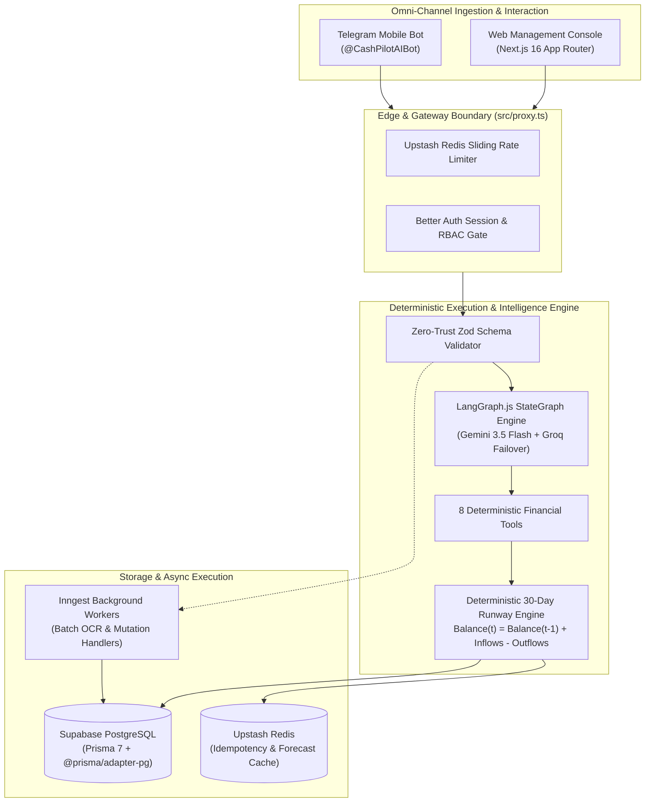

<div align="center">

# CashPilot AI

### Autonomous SME Financial Intelligence & Cash-Flow Copilot

[](https://sme-finance-copilot-ultron.vercel.app)
[](https://t.me/cash_pilot_ai_bot)
[](https://nextjs.org/)
[](https://bun.sh/)
[](https://www.prisma.io/)
[](https://supabase.com/)
[](https://langchain-ai.github.io/langgraphjs/)
[](https://ai.google.dev/)
[](https://upstash.com/)
[](https://www.inngest.com/)

<p align="center">
  <strong>Deterministic 30-day cash runway forecasting, zero-effort invoice ingestion, and human-in-the-loop autonomous payment workflows for forward-thinking SMEs.</strong>
</p>

<p align="center">
  <a href="https://sme-finance-copilot-ultron.vercel.app"><strong>🌐 Live Web App</strong></a> •
  <a href="https://t.me/cash_pilot_ai_bot"><strong>🤖 Telegram Bot (@cash_pilot_ai_bot)</strong></a> •
  <a href="#-quickstart">Quickstart</a> •
  <a href="#-architectural-mandates">Architecture</a> •
  <a href="#-core-capabilities">Capabilities</a> •
  <a href="#-pointed-documentation">Documentation Map</a>
</p>

---

</div>

## 📌 Executive Summary

**CashPilot AI** is an enterprise-grade agentic financial operating system engineered specifically for Small and Medium-sized Enterprises (SMEs). Traditional accounting platforms operate reactively on month-old historical reports, while generic generative AI models notoriously hallucinate arithmetic when asked to compute balances.

CashPilot AI solves this fundamental dilemma through **deterministic mathematical safety**:

1. **Zero LLM Arithmetic:** All balances, runway projections, and ledger aggregations execute exclusively through hardcoded TypeScript algorithms and verified PostgreSQL queries.
2. **AI as Intent Compiler:** Google Gemini 3.5 Flash and LangGraph.js orchestrate user intent, route to 8 verified deterministic backend tools, and synthesize verified tool outputs into natural language.
3. **Omni-Channel Synchrony:** A unified, real-time database powers both the responsive Web Management Console and the Telegram Bot—enabling receipt capture in the field and instant runway reconciliation at your desk.

---

## 🏛️ Pointed Documentation

The project includes thorough, specialized engineering specifications in the [`docs/`](docs/) directory. Refer to these companion documents for deep-dive architectural and operational details:

| Document                                                       | Primary Focus                          | Description                                                                                                               |
| :------------------------------------------------------------- | :------------------------------------- | :------------------------------------------------------------------------------------------------------------------------ |
| 📐 [**PROJECT_ARCHITECTURE.md**](docs/PROJECT_ARCHITECTURE.md) | **System Architecture & Blueprints**   | In-depth 7-layer architecture, LangGraph state machine definitions, entity relationships, and failure recovery protocols. |
| 🚀 [**DEPLOYMENT_GUIDE.md**](docs/DEPLOYMENT_GUIDE.md)         | **Production Runbook**                 | Step-by-step production setup across Vercel, Supabase PostgreSQL, Upstash Redis, Inngest, and Telegram Webhooks.          |
| 📱 [**TELEGRAM_INTIGRATION.md**](docs/TELEGRAM_INTIGRATION.md) | **Omni-Channel Telegram Bot**          | Telegram bot pairing protocol, deep-link authentication, receipt photo OCR pipeline, and command reference.               |
| 🎨 [**DESIGN.md**](docs/DESIGN.md)                             | **Design System & Visual Tokens**      | Editorial fintech UI tokens, dark/light contrast standards, Geist typography, and Shadcn component patterns.              |
| 💡 [**PRODUCT_VISION.pdf**](docs/PRODUCT_VISION.pdf)           | **Problem Statement & Product Vision** | Original market research, SME liquidity pain points, and strategic product requirements.                                  |
| 📋 [**PROJECT_PROGRESS.md**](docs/PROJECT_PROGRESS.md)         | **Milestone Roadmap**                  | Phased engineering history, delivered functionality, and technical verification log.                                      |
| 🛡️ [**AGENTS.md**](AGENTS.md)                                  | **Engineering Mandates**               | Strict non-negotiable compliance rules, zero-trust ingestion boundaries, and runtime requirements.                        |

---

## ⚙️ Architectural Mandates & System Design



### 1. Deterministic Financial Safety

Generative LLMs are mathematically non-deterministic and prone to calculation drift. In CashPilot AI:

- LLMs **never** calculate balances, project runway dates, sum invoices, or determine overdue amounts via raw text completion.
- Formulas like $\text{Balance}(t) = \text{Balance}(t-1) + \text{Inflows}(t) - \text{Outflows}(t)$ run purely in deterministic TypeScript with zero rounding errors.

### 2. Zero-Trust Ingestion & Schema Enforcing

- External inputs—including uploaded PDF invoices, CSV master files, Telegram webhooks, and AI tool outputs—are treated as hostile.
- Runtime [Zod](https://zod.dev/) schemas validate every field before database insertion. Parsing failures fail closed with row-level error reporting.

### 3. Strict Sovereign Tenant Isolation

- Every database transaction, audit event, and query strictly enforces `userId` filtering.
- Global or unqualified reads and writes are forbidden by design.

### 4. Human-in-the-Loop (HITL) Action Planning

- Read-only operations (`get_financial_summary`, `forecast_cash_balance`) execute autonomously.
- External side-effects (e.g. sending customer payment reminder messages) enter a strict `PENDING_APPROVAL` staging state requiring explicit human authorization.

---

## 🌟 Core Capabilities

### 1. Deterministic 30-Day Cash Runway Forecasting

- Continuous predictive modeling aggregating verified receivables (AR), upcoming supplier bills (AP), and fixed recurring overhead (rent, payroll, utilities).
- Dynamic safety reserve buffer monitoring with proactive alerts before liquidity deficits materialize.
- Interactive what-if scenario testing: calibrate cash velocity, simulate delayed customer receipts, or model capital expenditure spikes.

### 2. Multi-Modal Invoice & Bill Ingestion

- **CSV Master Files:** Drop multi-row accounting exports with instant column mapping, duplicate detection, and staged preview confirmation.
- **PDF & Image OCR:** Bun-native parsers extract counterparty, total liability, payment status, and due dates in under 3 seconds.
- **1-Click 30-Day Sample Dataset:** Pre-packaged with 30 realistic Bangladeshi SME invoices spanning receivables and payables for instant platform evaluation.

### 3. Agentic Financial Copilot (LangGraph.js)

- Natural language financial query compiler bound to 8 deterministic tools:
  - `get_financial_summary`: Reconciled balance, AR/AP totals, and working capital.
  - `get_invoices`: Filtered ledger queries by counterparty, status, or date range.
  - `get_upcoming_payables`: Prioritized supplier liabilities.
  - `get_upcoming_receivables`: Expected cash inflows with overdue tracking.
  - `forecast_cash_balance`: Forward rolling runway predictions.
  - `get_financial_alerts`: Rule-based deficit and risk alerts.
  - `create_reminder_draft`: Factual customer reminder drafts.
  - `record_action_status`: State transition approval logger.
- Multi-tier model resilience: **Google Gemini 3.5 Flash** (Primary) with automated failover to **Gemini 2.5 Flash** and **Groq Llama 3.3**.

### 4. Smart Accounts Receivable (AR) Follow-ups

- Algorithmic prioritization of overdue receivables based on outstanding balance, days past due, and deficit urgency.
- Factual reminder drafting populated strictly from verified invoice records.

### 5. Unified Omni-Channel Telegram Bot

- Field operators can snap photos of paper receipts or forward supplier PDFs directly to [**@cash_pilot_ai_bot**](https://t.me/cash_pilot_ai_bot).
- Invoices are parsed, validated, and instantly reflected in the [Web Management Console](https://sme-finance-copilot-ultron.vercel.app) with zero data silos.
- Direct Telegram link: [https://t.me/cash_pilot_ai_bot](https://t.me/cash_pilot_ai_bot)

### 6. Bank-Grade Auditability & Administration

- Immutable, append-only `AuditLog` recording every ingestion, analysis, agent tool execution, and user action.
- Administrative telemetry console (`/admin`, `/admin/telemetry`, `/admin/users`, `/admin/audit`) with live token usage and security oversight.

---

## 💻 Technology Stack

| Layer                  | Technology                                                                     | Version / Specification                 | Rationale                                                                                    |
| :--------------------- | :----------------------------------------------------------------------------- | :-------------------------------------- | :------------------------------------------------------------------------------------------- |
| **Runtime & Tooling**  | [Bun](https://bun.sh/)                                                         | `1.4.x`                                 | Native high-performance execution, sub-second installs, and test runner.                     |
| **Web Framework**      | [Next.js](https://nextjs.org/)                                                 | `16.4.0` (Turbopack)                    | Modern App Router, Server Components, and edge routing via `src/proxy.ts`.                   |
| **Database & ORM**     | [Prisma](https://www.prisma.io/) + [PostgreSQL](https://supabase.com/)         | `7.10.x` (`@prisma/adapter-pg`)         | Type-safe schema migrations, connection pooling, and multi-tenant isolation.                 |
| **Authentication**     | [Better Auth](https://www.better-auth.com/)                                    | `1.7.x`                                 | Stateful session cookies, Prisma adapter, admin plugin, and RBAC protection.                 |
| **Agent Workflow**     | [LangGraph.js](https://langchain-ai.github.io/langgraphjs/)                    | `1.4.x`                                 | Stateful cyclical multi-agent graph with deterministic tool calling.                         |
| **AI SDK**             | [Vercel AI SDK](https://sdk.vercel.ai/)                                        | `7.0.x` (`@ai-sdk/langchain`)           | Streaming SSE chat responses with tool visualization.                                        |
| **Primary LLM**        | [Google Gemini](https://ai.google.dev/)                                        | `gemini-3.5-flash` / `gemini-2.5-flash` | Generous free-tier rate limits, high multimodal OCR accuracy, fast latency.                  |
| **Fallback LLM**       | [Groq](https://groq.com/)                                                      | `llama-3.3-70b-versatile`               | Ultra-fast open-source fallback ensuring high availability.                                  |
| **Cache & Throttling** | [Upstash Redis](https://upstash.com/)                                          | `@upstash/ratelimit`                    | Sliding-window edge rate limiting in `proxy.ts`, idempotency, and forecast caching.          |
| **Background Jobs**    | [Inngest](https://www.inngest.com/)                                            | `4.24.x`                                | Durable async workers for heavy OCR, nightly forecast recalculations, and reminder dispatch. |
| **Validation**         | [Zod](https://zod.dev/)                                                        | `4.x` / `3.x`                           | End-to-end type inference and fail-closed runtime parsing.                                   |
| **Styling & UI**       | [Tailwind CSS](https://tailwindcss.com/) + [Shadcn UI](https://ui.shadcn.com/) | `v4.0` + Radix Primitives               | Accessible tokens, responsive dark/light theme, and editorial fintech layout.                |

---

## 📂 Repository Structure

```text
sme_finance_copilot/
├── data/
│   └── sample_data.csv             # 30-day validated realistic SME benchmark dataset
├── docs/                           # Pointed specialized architectural specifications
│   ├── DEPLOYMENT_GUIDE.md         # Production deployment manual
│   ├── DESIGN.md                   # UI design tokens & styling standards
│   ├── PRODUCT_VISION.pdf          # Market positioning & product requirements
│   ├── PROJECT_ARCHITECTURE.md     # 7-layer architecture & state machine blueprints
│   ├── PROJECT_PROGRESS.md         # Implementation roadmap & milestone log
│   └── TELEGRAM_INTIGRATION.md     # Telegram Bot pairing & webhook documentation
├── prisma/
│   ├── schema.prisma               # Main Prisma schema file
│   ├── user.prisma                 # User & tenant models
│   ├── invoice.prisma              # Accounts receivable & payable ledger
│   ├── transaction.prisma          # Realized & projected cash movements
│   ├── audit-log.prisma            # Immutable audit trail
│   ├── conversation.prisma         # Multi-turn chat persistence
│   └── ...                         # Domain schemas
├── public/
│   ├── app_fill_logo.svg           # High-resolution brand logo & favicon
│   └── ...                         # Static icons & illustrations
├── src/
│   ├── app/                        # Next.js 16 App Router
│   │   ├── (auth)/                 # Authentication routes (sign-in, sign-up)
│   │   ├── (dashboard)/            # Authenticated application console
│   │   │   ├── dashboard/          # Real-time cash overview & KPI cards
│   │   │   ├── forecast/           # Interactive 30-day runway projection
│   │   │   ├── invoices/           # Invoices & accounts ledger table
│   │   │   ├── alerts/             # Deficit alerts & risk matrix
│   │   │   ├── copilot/            # AI Financial Copilot chat interface
│   │   │   ├── audit/              # Immutable audit trail stream
│   │   │   └── settings/           # Cash reserve & organization configuration
│   │   ├── admin/                  # Administrative & telemetry portal
│   │   ├── api/                    # Type-safe API endpoints
│   │   │   ├── chat/               # LangGraph Copilot streaming endpoint
│   │   │   ├── forecast/           # Deterministic runway calculation API
│   │   │   ├── ingest/             # Multi-modal CSV/PDF staging & commit
│   │   │   ├── invoices/           # Ledger CRUD & sample data seeding
│   │   │   ├── telegram/           # Bot webhook & account pairing
│   │   │   └── inngest/            # Inngest async worker handler
│   │   ├── layout.tsx              # Root HTML layout with favicon metadata
│   │   └── page.tsx                # High-conversion landing page
│   ├── components/                 # Reusable Shadcn UI & domain components
│   │   ├── dashboard/              # Cockpit charts, banners, and ledger widgets
│   │   ├── landing/                # Modern minimalist landing page sections
│   │   └── ui/                     # Accessible Shadcn design primitives
│   ├── lib/                        # Singletons (Prisma, Redis, Auth, Inngest)
│   ├── proxy.ts                    # Edge interceptor (Better Auth & Upstash rate limiter)
│   ├── services/                   # Pure business logic & calculation engines
│   │   ├── forecast.ts             # Deterministic 30-day cash runway calculator
│   │   ├── invoice.ts              # Ledger aggregations & monthly maintenance
│   │   ├── alerts.ts               # Rule-based risk evaluation engine
│   │   ├── agent-tools.ts          # 8 deterministic LangGraph tools
│   │   ├── csv-ingestion.ts        # Zero-trust CSV parsing & staging
│   │   ├── document-ocr.ts         # Multimodal PDF extraction engine
│   │   └── sample-data.ts          # 1-click sample dataset seed engine
│   └── validations/                # Canonical Zod schemas
├── AGENTS.md                       # Non-negotiable agent compliance directives
├── biome.json                      # Biome linter & formatter configuration
├── bun.lock                        # Deterministic Bun dependency lockfile
├── package.json                    # Project metadata & scripts
├── prisma7.config.ts               # Prisma 7 configuration file
└── tsconfig.json                   # Strict TypeScript compiler configuration
```

---

## ⚡ Quickstart

### 1. Prerequisites

- [Bun](https://bun.sh/) (v1.2+ required)
- PostgreSQL Database (e.g. [Supabase](https://supabase.com/))
- Upstash Redis instance (for rate limiting and cache)

### 2. Clone & Install Dependencies

```bash
git clone https://github.com/iamabraryeasir/sme_finance_copilot.git
cd sme_finance_copilot

# Install dependencies using Bun exclusively
bun install
```

### 3. Environment Configuration

Copy `.env.example` to `.env`:

```bash
cp .env.example .env
```

Configure the environment variables:

```ini
# Database (PostgreSQL via Supabase)
DATABASE_URL="postgresql://postgres:[PASSWORD]@[HOST]:5432/postgres?sslmode=require"

# Better Auth Configuration
BETTER_AUTH_SECRET="your-32-character-random-secret-key"
BETTER_AUTH_URL="http://localhost:3000"

# Initial System Administrator Credentials
ADMIN_NAME="System Administrator"
ADMIN_EMAIL="admin@cashpilot.ai"
ADMIN_PASSWORD="AdminSecurePassword123!"

# Free-Tier LLM Providers (No OpenAI/Anthropic required)
GEMINI_API_KEY="your-google-gemini-api-key"
GROQ_API_KEY="your-groq-api-key"

# Upstash Redis (Rate limiting & forecast cache)
UPSTASH_REDIS_REST_URL="https://your-upstash-instance.upstash.io"
UPSTASH_REDIS_REST_TOKEN="your-upstash-rest-token"

# Inngest (Async workers & scheduled cron rollups)
INNGEST_EVENT_KEY="your-inngest-event-key"
INNGEST_SIGNING_KEY="your-inngest-signing-key"

# Telegram Bot (Optional)
TELEGRAM_BOT_TOKEN="your-telegram-bot-token"
TELEGRAM_WEBHOOK_SECRET="your-telegram-webhook-secret"
NEXT_PUBLIC_APP_URL="http://localhost:3000"
```

### 4. Database Setup & Seeding

```bash
# Push Prisma schema to your PostgreSQL database
bun run db:push

# Seed the administrator account
bun run db:seed
```

### 5. Access Live Production or Launch Locally

- **Production Web Application:** [https://sme-finance-copilot-ultron.vercel.app](https://sme-finance-copilot-ultron.vercel.app)
- **Production Telegram Bot:** [@cash_pilot_ai_bot](https://t.me/cash_pilot_ai_bot) (`https://t.me/cash_pilot_ai_bot`)
- **1-Click Test Credentials:** Email: `demo@demo.com` | Password: `demo123@#`

To run locally:

```bash
bun run dev
```

Open [http://localhost:3000](http://localhost:3000) in your browser:

- **Landing Page:** Interactive value overview with dynamic session buttons.
- **Sign In (`/sign-in`):** Use the 1-Click **"Quick Demo Login"** button (`demo@demo.com` / `demo123@#`) or sign in with your administrator account.
- **Onboarding:** Click **"Load 30-Day Sample Dataset"** on the dashboard to immediately populate 30 realistic invoices, activate real-time runway forecasting, and test AI Copilot queries.

---

## 🛠️ Development & Operational Scripts

```bash
# Development server with Turbopack
bun run dev

# Run Biome linter across all files
bun run lint

# Auto-fix linting and formatting issues
bun run lint:fix

# Type check the codebase
bunx tsc --noEmit

# Production build verification (Prisma generate + Next.js build)
bun run build

# Start production server
bun run start

# Launch Prisma Studio to inspect database records
bun run db:studio

# Run Inngest local development server
bun run inngest:dev
```

---

## 🔐 Security & Compliance Architecture

- **Next.js 16 Edge Interception:** Network-level route protection and session verification execute via `src/proxy.ts` (Next.js 16 App Router standard; legacy `middleware.ts` is deprecated and forbidden).
- **Rate Limiting:** Sliding-window rate limiting via `@upstash/ratelimit` blocks DDoS and brute-force attempts at the edge.
- **Fail-Closed Audit Trail:** All critical business state transitions create an immutable record in `AuditLog` capturing timestamp, actor (`USER`, `AGENT`, `SYSTEM`, `TELEGRAM`), entity ID, and delta payload.
- **Idempotency Safeguards:** Ingestion operations generate unique deduplication hashes to prevent double-counting of invoices or ledger entries.

---

## 👥 Authors & Acknowledgments

- **Designed & Engineered by:** [Abrar Yeasir](https://github.com/iamabraryeasir)
- Built for SME financial leaders seeking absolute mathematical clarity and autonomous operational peace of mind.

---

<div align="center">
  <sub>© 2026 CashPilot AI. Enterprise Agentic Financial Infrastructure. Distributed under the MIT License.</sub>
</div>
