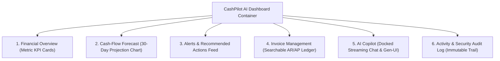
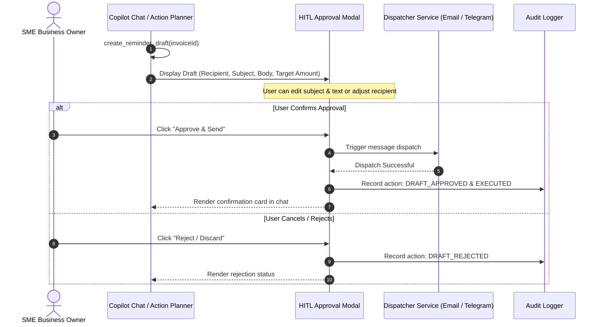

# CashPilot AI: Enterprise Design & UI/UX Specification

## 1. Core Design Philosophy & Visual Tokens

CashPilot AI delivers an enterprise-grade, financial operations console designed for executive clarity, high-density data legibility, and zero cognitive friction. It adheres strictly to **Tailwind CSS v4** and **Shadcn UI** design primitives.

### Strict Design Token Enforcements
- **No Hardcoded Hex Colors:** Arbitrary color codes (`#FF5733`, etc.) and hardcoded Tailwind color scales (`bg-blue-500`, `text-emerald-600`) are strictly forbidden. All styles must consume semantic CSS variables declared in `src/app/globals.css`.
- **Semantic Color Tokens:**
  - `bg-background` / `text-foreground`: Base canvas and high-contrast typography.
  - `bg-card` / `text-card-foreground`: Elevated surface for all discrete modules.
  - `bg-muted` / `text-muted-foreground`: Secondary backgrounds, supporting metadata, and inactive states.
  - `bg-primary` / `text-primary-foreground`: Primary interactive calls-to-action (CTAs).
  - `bg-secondary` / `text-secondary-foreground`: Auxiliary filters, secondary actions, and badges.
  - `bg-destructive` / `text-destructive`: Financial deficits, overdue states, and critical warnings.
  - `border-border` / `border-input`: Subtle, consistent borders framing cards and forms.
  - `ring-ring`: Focus states ensuring accessibility compliance (WCAG 2.1 AA).
- **Typography & Formatting:**
  - Font Stack: `Inter` or `Geist Sans` for UI prose; `Geist Mono` for financial tables, invoice numbers, timestamps, and currency amounts.
  - Currency Formatting: Consistent display format (`৳` BDT or `$` USD) with thousands separators and 2 decimal points (e.g. `৳250,000.00`).

---

## 2. Main Dashboard Layout & The 6 Core Sections

The Web Dashboard is architected as a cohesive, high-density single-page command center organized into six distinct functional panels:

### Section 1: Financial Overview (KPI Metrics Grid)
Positioned at the top of the dashboard as a responsive 6-card grid (1 col mobile, 3 col tablet, 6 col desktop):
1. **Current Cash Balance:** Verified real-time balance in primary operational currency.
2. **Expected Incoming Payments:** Total Accounts Receivable (AR) due within the next 30 days.
3. **Upcoming Outgoing Payments:** Total Accounts Payable (AP) + fixed obligations due within the next 30 days.
4. **Projected Minimum Cash Balance:** The lowest projected daily balance in the 30-day forecast, with an indicator showing the date of lowest balance.
5. **Overdue Receivables:** Cumulative value of past-due customer invoices requiring immediate follow-up.
6. **Active Financial Alerts:** Pill count of active operational hazards categorized by severity.

### Section 2: Cash-Flow Forecast (30-Day Projection Chart)
Encapsulated in a prominent `Card` component spanning full width or 8 columns in a 12-column layout:
- **Visualization:** Interactive Recharts / SVG area-and-line chart plotting projected closing cash balances for Days $t = 1 \dots 30$.
- **Reference Elements:**
  - **Minimum Reserve Threshold Line:** A dashed horizontal reference line showing the user-configured safety reserve.
  - **Deficit Alert Zone:** Shaded red fill whenever projected balance dips below the safety reserve or into negative territory.
  - **Daily Inflows & Outflows:** Stacked bar or tooltip breakdown detailing the specific customer payments and supplier expenses driving each day's delta.
- **Header Controls:**
  - Date range selector (Next 30 Days default, 14 Days, 60 Days).
  - "Simulate Scenario" toggle allowing rapid what-if expense testing.

### Section 3: Alerts & Recommended Actions Feed
A prioritized feed of operational risks sorted by deterministic severity:
- **Card Hierarchy:**
  - **Severity Badge:** `CRITICAL` (Destructive/Red), `HIGH` (Amber/Warning), `MEDIUM` (Secondary), `LOW` (Muted).
  - **Alert Header:** Clear risk statement (e.g. *"Projected Cash Shortage in 8 Days"*, *"3 Overdue Customer Invoices"*).
  - **Root-Cause Attribution:** Expandable details citing the specific driving invoices/transactions (e.g. *"Driven by Supplier XYZ invoice of ৳180,000 due Nov 4 without matching incoming receipts"*).
  - **Suggested Next Action:** Prescriptive recommendation button (e.g. *"Draft Payment Reminder"*, *"Delay Supplier Payment"*, *"Inspect Expense"*).

### Section 4: Invoice Management (Searchable Ledger)
A full-featured, responsive data table built with Shadcn `Table`, `Badge`, and `Button`:
- **Tabs:** `All Invoices` | `Receivables (AR)` | `Payables (AP)` | `Overdue`.
- **Table Columns:**
  - `Invoice #` (Monospace, e.g. `INV-2026-042`).
  - `Counterparty` (Customer or Supplier name).
  - `Type` (AR / AP chip).
  - `Total Amount` & `Remaining Balance` (Handling partial payments cleanly).
  - `Due Date` & Days Overdue indicator.
  - `Status` (`PENDING`, `PARTIALLY_PAID`, `OVERDUE`, `PAID`, `CANCELLED`).
  - `Actions`: Quick menu offering *"Prepare Reminder"*, *"Mark Paid"*, *"View Source Document"*.
- **Search & Filters:** Real-time customer name search, date range filter, and status dropdown.

### Section 5: AI Copilot (Docked Streaming Chat & Generative UI)
An omnipresent financial assistant accessible either as a docked right sidebar (4 cols on desktop) or an expandable slide-over drawer:
- **Capabilities:**
  - Streaming real-time completions powered by Vercel AI SDK (`useChat`).
  - **Quick Prompt Pills:**
    - *"Can I afford to purchase ৳200,000 of inventory?"*
    - *"Which customers owe me the most money?"*
    - *"Why is my projected cash balance falling?"*
    - *"Prepare reminders for overdue customer invoices."*
  - **Generative UI Widgets:** Tool execution renders structured cards inline in the chat (e.g., Mini Forecast Chart widget, Overdue Customer Card, Drafted Reminder preview).

### Section 6: Activity & Security Audit Log
An enterprise audit log mounted at the bottom of the dashboard or in a dedicated `/audit` route:
- **Audit Columns:**
  - `Timestamp` (UTC ISO formatted).
  - `Actor` (`USER`, `AGENT`, `SYSTEM`, `TELEGRAM` with distinct icons).
  - `Action Type` (`INGESTION`, `FORECAST_RUN`, `ALERT_DETECTED`, `REMINDER_DRAFTED`, `REMINDER_APPROVED`, `REMINDER_DISPATCHED`).
  - `Entity / Target` (`Invoice #INV-2026-042`, etc.).
  - `Status` (`SUCCESS`, `PENDING_APPROVAL`, `FAILED`).
  - `Details`: Modal dialog allowing developers and compliance auditors to inspect the raw JSON delta.

---

## 3. Human-in-the-Loop (HITL) Action Approval Workflow

When the AI Copilot prepares an external business action (such as drafting an overdue invoice reminder to a customer), it never dispatches it autonomously. It invokes an interactive approval modal:

---

## 4. Ingestion Experience & Error Handling UI

1. **Multi-Format Dropzone:**
   - Supports Drag-and-Drop for CSV files, PDF invoices, and receipt images (PNG, JPEG).
   - Shows live file size and MIME-type validation before sending.
2. **Deterministic Error Reporting Modal:**
   - When a CSV file contains malformed rows, missing fields, or invalid dates, the UI displays a structured error table indicating:
     - `Row #` | `Field Name` | `Invalid Value` | `Required Correction`.
   - The user is given options to download the corrected template or upload a revised file.

---

## 5. Telegram Bot UI/UX Interaction Design

The Telegram interface acts as a seamless extension of CashPilot AI:
- **Command Menu:**
  - `/start`: Welcome message, system status, and link instructions.
  - `/link <code>`: Pair Telegram chat with Web SME account.
  - `/summary`: Real-time financial overview card with key metrics.
  - `/forecast`: 30-day projected liquidity summary and deficit warnings.
  - `/alerts`: Priority list of active risks and overdue payments.
- **Document Handling:**
  - Users forward or attach PDF / image invoices directly in Telegram.
  - Bot acknowledges receipt, parses via backend OCR, and replies with extracted data:
    > 📄 **Invoice Extracted:** `INV-2026-089`  
    > 👤 **Supplier:** Dhaka Office Supplies  
    > 💰 **Amount:** ৳45,000.00  
    > 📅 **Due Date:** 2026-11-15  
    > ⚡ *Forecast updated. Balance remains healthy.*
- **Interactive Inline Keyboards:**
  - Overdue reminder alerts include inline buttons: `[ Draft Reminder ]` | `[ View Invoice ]` | `[ Dismiss ]`.