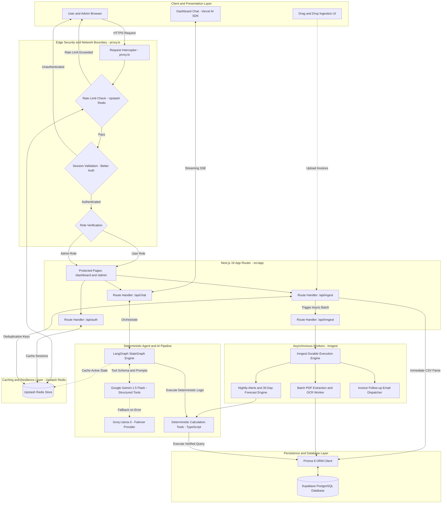
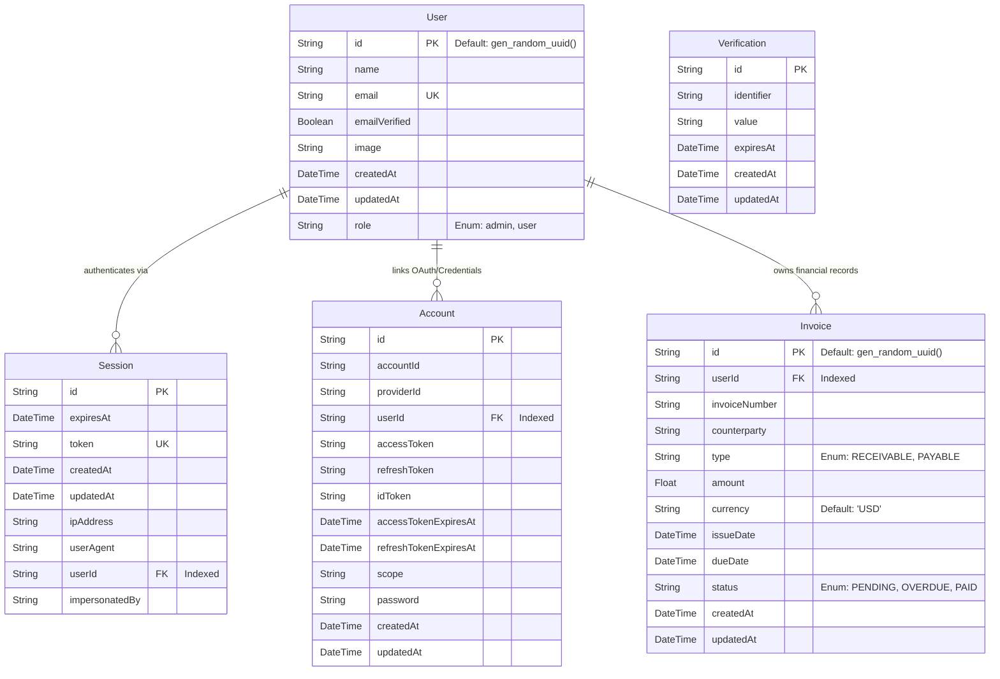

# PROJECT_ARCHITECTURE.md

## 1. System Overview & Core Philosophy

The SME Finance Copilot is a highly secure, enterprise-grade financial application built on Next.js 16+. It provides business owners with 30-day cash flow forecasting, alert generation, and an AI agent capable of drafting invoice follow-ups. The architecture is designed to integrate safely into core banking systems, prioritizing determinism, auditability, and zero-trust data handling.

**Key Constraints & Enterprise Mandates:**

- **Zero-Trust AI:** No RAG. The LLM cannot perform math. It acts only as a reasoning engine over verified database outputs via deterministic tool calling.
- **Enterprise Scalability:** Utilize Redis for rate-limiting and session caching, and Inngest for durable, asynchronous background job execution.
- **Strict Budget Compliance:** Rely on Gemini 1.5 Flash/Groq free tiers, Supabase PostgreSQL, Upstash Redis (Free Tier), and Vercel Hobby deployments.
- **Runtime:** `bun` is the exclusive package manager and runtime.
- **Modern Next.js (v16+):** Use App Router. Use `proxy.ts` for edge interception and rate-limiting; `middleware.ts` is strictly forbidden.

---

## 2. Global Architecture & Network Boundaries

### System Architecture Diagram



### Folder Structure Convention

```text
|
├── prisma/
│   ├── schema.prisma       # Prisma 8 definition file
│   └── prisma.config.ts    # Prisma 8 config using definePrismaConfig
├── src/
│   ├── app/
│   │   ├── (auth)/         # /sign-in, /sign-up routes
│   │   ├── (dashboard)/    # /dashboard (User view)
│   │   ├── (admin)/        # /admin (Admin monitoring view)
│   │   └── api/            # Route Handlers
│   │       ├── auth/[...all]/route.ts  # Better Auth API endpoints
│   │       ├── chat/route.ts           # LangGraph + Vercel AI SDK bridge
│   │       ├── ingest/route.ts         # CSV/PDF data parsing endpoint
│   │       └── inngest/route.ts        # Inngest background job webhooks
│   ├── components/
│   │   ├── ui/             # Shadcn components (installed via bunx)
│   │   └── shared/         # Custom composite components (charts, dropzones)
│   ├── lib/
│   │   ├── auth.ts         # Better Auth server instance
│   │   ├── auth-client.ts  # Better Auth client instance
│   │   ├── prisma.ts       # Prisma 8 client initialization
│   │   ├── redis.ts        # Upstash Redis client
│   │   ├── inngest/        # Inngest client and job definitions
│   │   │   ├── client.ts
│   │   │   └── functions/  # E.g., process-invoice-batch, scheduled-forecasts
│   │   └── ai/             # LangGraph state machine & tools definitions
│   └── proxy.ts            # Network boundary, role protection, & rate-limiting
```

### Edge Security & Route Protection (`proxy.ts`)

- **Location:** `src/proxy.ts` (or project root).
- **Functionality:**
  - **Rate Limiting:** Integrates with Upstash Redis to apply strict rate limits (e.g., 100 requests per minute per IP) to prevent DDoS and API abuse.
  - **Session Validation:** Intercepts incoming requests and validates Better Auth stateful sessions.
- **Role Routing:**
  - Unauthenticated users are redirected to `/sign-in`.
  - Authenticated users with `role: "user"` are granted access to `/dashboard`.
  - Authenticated users with `role: "admin"` are granted access to `/admin` monitoring panels.

---

## 3. Data Storage & Schema (Prisma 8)

**Mandatory Prisma 8 Rules:**

- The schema MUST begin with `// use prisma-8`.
- Do not use legacy `@db.*` types; write storage types in the type position.
- Use `sql` tag for defaults, e.g., `@default(sql gen_random_uuid())`.

### Unified Schema Definition



## 4. Agentic Workflow & Background Processing

### The Engine (Server-Side `lib/ai/graph.ts`)

- **StateGraph:** Maintains conversational memory, the `userId`, and system context.
- **Tools:** Implemented purely as deterministic TypeScript functions executing Prisma queries.
- **No Mathematical Generation:** The LLM injects JSON parameters into tools and summarizes the JSON response.

### Durable Execution (Inngest)

To ensure the system meets banking-grade reliability standards, long-running or failure-prone tasks are offloaded from Next.js Route Handlers:

- **Batch PDF Extraction:** When a user uploads 50 invoices, the UI returns instantly. Inngest handles the asynchronous LLM parsing in the background with automatic retries on rate limits.
- **Scheduled Financial Alerts:** An Inngest cron job runs nightly to recalculate the 30-day forecast and push database alerts for invoices that became overdue that day.
- **Email Delivery:** Drafting and sending follow-up emails via the Copilot triggers an Inngest event, ensuring the email is delivered even if the Vercel edge function times out.

### High-Speed Caching & Resilience (Redis)

- **Session Caching:** Better Auth queries are backed by Redis to reduce load on the primary PostgreSQL database.
- **Agent State:** LangGraph conversational state can be temporarily persisted in Redis for ultra-fast retrieval during active chat sessions.
- **Idempotency Keys:** Redis stores idempotency keys for transaction processing to guarantee that an invoice is never ingested or paid twice due to network retries.

---

## 5. Implementation Strategy (Layer-by-Layer)

1. **Phase 1: Foundation, Auth, & Edge Security**
   - ✅ Setup Next.js, Bun, Tailwind, Shadcn.
   - Initialize Prisma 8, Supabase connection, and define the schema.
   - Implement Better Auth endpoints.
   - Set up Upstash Redis and integrate rate-limiting into `proxy.ts`.

2. **Phase 2: Data Ingestion & Event-Driven Architecture**
   - Build the drag-and-drop UI component.
   - Implement `/api/ingest` for immediate CSV parsing.
   - Setup Inngest client and implement background workers for heavy PDF OCR extraction and batch inserts.

3. **Phase 3: Deterministic Financial Engines**
   - Build the TypeScript utility functions for cash flow projection.
   - Wire these utilities to frontend Dashboard charts.
   - Create an Inngest cron job to compute nightly financial health checks.

4. **Phase 4: Agentic Copilot**
   - Define LangGraph nodes and deterministic database tools.
   - Implement `/api/chat` using Vercel AI SDK streaming.
   - Render the chat UI on the Dashboard with Generative UI tool components.
