# CashPilot AI: Enterprise System Architecture & Engineering Specification

## 1. Executive Summary & Product Vision

**CashPilot AI** is an enterprise-grade, agentic financial operations platform purpose-built for Small and Medium-sized Enterprises (SMEs). SMEs regularly navigate financial fragmentation across spreadsheets, paper invoices, PDF receipts, bank statements, and messaging channels. Business owners frequently understand top-line revenue but lack visibility into upcoming liquidity deficits, delayed receivables, upcoming operational obligations, and compounding financial risk.

CashPilot AI bridges this gap through an **omni-channel agentic financial copilot** providing:
1. **Deterministic 30-Day Cash-Flow Forecasting** with dynamic scenario and reserve analysis.
2. **Proactive, Rule-Based Financial Risk Alerts** with root-cause attribution.
3. **Multi-Channel Ingestion (Web & Telegram)** with zero-trust validation and OCR extraction.
4. **Actionable Financial Workflows (Invoice Follow-Up Planner)** governed by strict Human-in-the-Loop (HITL) approval gates.
5. **Immutable Activity & Security Audit Logging** recording every analysis, recommendation, draft, and state mutation.

---

## 2. Core Architectural Principles (Senior SWE Mandates)

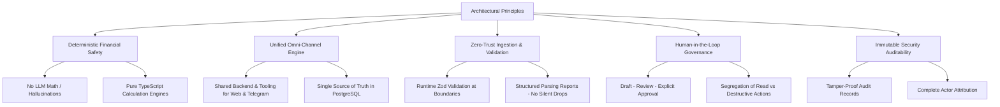

1. **Deterministic Financial Safety (Anti-Hallucination):**
   - Large Language Models (LLMs) are strictly prohibited from performing arithmetic, computing ledger balances, generating cash projections, or assigning risk severity scores via text generation.
   - All financial mathematics, rollups, and alerts originate from verifiable, deterministic TypeScript calculation engines and PostgreSQL queries.
   - The LLM functions exclusively as a natural language intent compiler, tool retrieval orchestrator, and synthesizer of verified tool payloads.
2. **Unified Omni-Channel Core Engine:**
   - Both the Web Application (Next.js 16) and the Telegram Bot interact with the **exact same backend API, business database, financial calculation engines, and LangGraph agent tools**.
   - They never operate as isolated or divergent bots. A transaction uploaded via Telegram instantly recalculates forecasts and updates the Web Dashboard in real time.
3. **Zero-Trust Ingestion & Schema Enforcing:**
   - Every external payload (CSV upload, Telegram document, OCR extraction, webhook) is untrusted until validated through strict Zod schemas.
   - Parsing failures return structured error reports detailing specific invalid rows and columns; invalid records are never silently dropped or assumed.
4. **Human-in-the-Loop (HITL) Action Governance:**
   - Actions are strictly tiered: Read-only operations (auto-approved), internal mutations (e.g., storing validated invoices), and external/consequential operations (e.g., sending payment reminders or supplier notices).
   - Consequential external actions mandate explicit human approval (`PENDING_APPROVAL` $\rightarrow$ `APPROVED`).
5. **Verifiable Audit Trails:**
   - Every agent recommendation, prompt, tool execution, user confirmation, and invoice transition is permanently recorded in an immutable `AuditLog` table with timestamp, actor type, entity ID, and status metadata.

---

## 3. High-Level Omni-Channel System Architecture

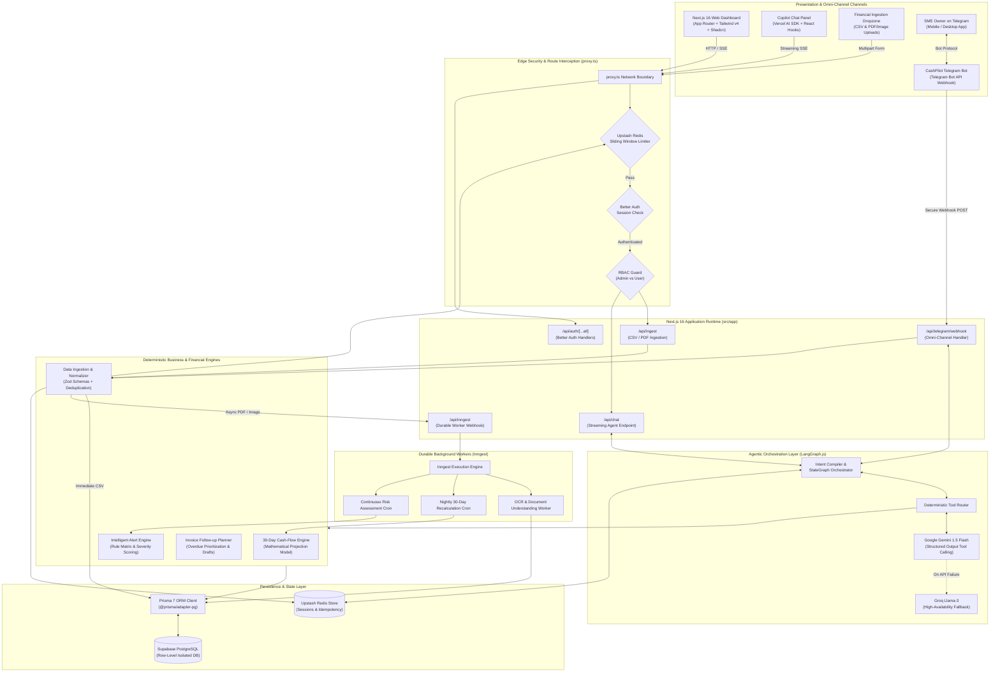

---

## 4. Comprehensive Senior SWE Entity-Relationship Diagram (ERD)

The relational architecture is modeled to support strict multi-tenant isolation, enterprise financial ledgering, omni-channel identity linking, proactive risk telemetry, and auditable human-in-the-loop workflows.

```mermaid
erDiagram
  User ||--o{ Session : "authenticates"
  User ||--o{ Account : "links credentials/OAuth"
  User ||--|| BusinessProfile : "owns financial settings"
  User ||--o{ RecurringSchedule : "defines fixed overhead commitments"
  User ||--o{ TelegramAccount : "links omni-channel identity"
  User ||--o{ Invoice : "owns ledger records"
  User ||--o{ Transaction : "records cash movements"
  User ||--o{ FinancialAlert : "receives risk alerts"
  User ||--o{ ActionDraft : "reviews follow-up drafts"
  User ||--o{ DocumentUpload : "submits ingestion files"
  User ||--o{ AuditLog : "traces actions & mutations"
  User ||--o{ Conversation : "maintains copilot sessions"

  Conversation ||--o{ Message : "contains thread messages"
  Invoice ||--o{ Transaction : "reconciles payments against"
  Invoice ||--o{ ActionDraft : "generates reminder drafts for"
  DocumentUpload ||--o{ Invoice : "extracts structured records into"
  RecurringSchedule ||--o{ Transaction : "generates projected cash outflows for"

  User {
    String id PK "UUID cryptographic primary key"
    String name "Business owner or contact name"
    String email UK "Unique verified corporate email"
    Boolean emailVerified "Email validation flag"
    String image "Avatar URL"
    String role "RBAC: admin | user"
    Boolean banned "Administrative ban status"
    String banReason "Justification for ban"
    DateTime banExpires "Ban expiry timestamp"
    DateTime createdAt "Record creation timestamp"
    DateTime updatedAt "Last modification timestamp"
  }

  BusinessProfile {
    String id PK "UUID"
    String userId FK "Unique 1:1 relation to User"
    String companyName "Registered SME business legal name"
    String currency "Default operational currency (e.g. BDT ৳, USD $)"
    Float openingBalance "Current verified starting cash balance"
    DateTime openingBalanceDate "Date opening balance was established"
    Float minReserveThreshold "Configured minimum safety reserve buffer"
    Int latePaymentAssumptionDays "Conservative delay buffer for receivables"
    Int upcomingPaymentAlertDays "Horizon for supplier payment alerts (default 3 days)"
    Float expenseBaselineMonthly "Historical baseline for unusual expense detection"
    DateTime createdAt "Profile creation timestamp"
    DateTime updatedAt "Last profile update"
  }

  RecurringSchedule {
    String id PK "UUID"
    String userId FK "Indexed relation to User"
    String title "Schedule name (e.g. Office Rent, Staff Payroll, Bank Loan)"
    String category "RENT | PAYROLL | LOAN_REPAYMENT | UTILITIES | TAX | OTHER"
    Float amount "Scheduled recurring cash commitment"
    String currency "Currency code"
    String frequency "MONTHLY | WEEKLY | BIWEEKLY | QUARTERLY | ANNUALLY"
    Int dayOfMonth "Scheduled execution day (e.g. 1st or 28th)"
    DateTime nextDueDate "Next calculated obligation maturity date"
    Boolean isActive "Active scheduling flag"
    DateTime createdAt "Schedule creation timestamp"
    DateTime updatedAt "Schedule update timestamp"
  }

  Session {
    String id PK "UUID"
    String token UK "Secure session bearer token"
    String userId FK "Indexed relation to User"
    DateTime expiresAt "Absolute session expiry"
    String ipAddress "Client IP address"
    String userAgent "Client browser user agent"
    String impersonatedBy "Admin impersonation tracking ID"
    DateTime createdAt "Session creation timestamp"
    DateTime updatedAt "Session update timestamp"
  }

  Account {
    String id PK "UUID"
    String userId FK "Indexed relation to User"
    String providerId "Auth provider identifier (credentials, etc.)"
    String accountId "External or local account reference"
    String password "Bcrypt/Argon2 hashed credential string"
    String accessToken "Provider token"
    String refreshToken "Provider refresh token"
    DateTime accessTokenExpiresAt "Token expiration"
    DateTime refreshTokenExpiresAt "Refresh expiration"
    String scope "OAuth scopes"
    String idToken "OIDC ID token"
    DateTime createdAt "Creation timestamp"
    DateTime updatedAt "Update timestamp"
  }

  Verification {
    String id PK "UUID"
    String identifier "Target email or phone verification identifier"
    String value "Hashed verification token or OTP secret"
    DateTime expiresAt "Absolute token expiration timestamp"
    DateTime createdAt "Record creation timestamp"
    DateTime updatedAt "Last modification timestamp"
  }

  TelegramAccount {
    String id PK "UUID"
    String userId FK "Unique 1:1 relation to User"
    String telegramUserId UK "Telegram unique numeric user ID"
    String telegramUsername "Telegram handle (@username)"
    String chatId "Active conversation chat ID"
    String linkToken "One-time cryptographically secure verification PIN"
    DateTime linkTokenExpiresAt "Expiry for pairing PIN (15 min window)"
    Boolean isVerified "Channel authorization status"
    DateTime linkedAt "Timestamp when linking was verified"
    DateTime createdAt "Creation timestamp"
    DateTime updatedAt "Update timestamp"
  }

  Invoice {
    String id PK "UUID"
    String userId FK "Indexed relation to User"
    String invoiceNumber "Unique business invoice code (e.g. INV-2026-001)"
    String counterparty "Customer name (AR) or Supplier name (AP)"
    String counterpartyEmail "Customer or supplier billing email"
    String counterpartyPhone "Customer or supplier contact phone"
    String type "RECEIVABLE (incoming) | PAYABLE (outgoing)"
    Float totalAmount "Total gross invoiced liability"
    Float paidAmount "Cumulative settled amount (handles partial payments)"
    Float remainingAmount "Outstanding balance (indexed for queries)"
    String currency "Transaction ISO currency code"
    DateTime issueDate "Invoice creation/billing date"
    DateTime dueDate "Agreed settlement due date"
    String status "PENDING | PARTIALLY_PAID | OVERDUE | PAID | CANCELLED"
    String source "WEB_CSV | WEB_UPLOAD | TELEGRAM | MANUAL"
    String documentUploadId FK "Optional FK linking to source document"
    DateTime lastReminderSentAt "Timestamp of most recent customer reminder"
    DateTime createdAt "Creation timestamp"
    DateTime updatedAt "Update timestamp"
  }

  Transaction {
    String id PK "UUID"
    String userId FK "Indexed relation to User"
    String invoiceId FK "Optional FK linking transaction to Invoice"
    String recurringScheduleId FK "Optional FK linking to RecurringSchedule"
    String type "INFLOW (cash in) | OUTFLOW (cash out)"
    String category "CUSTOMER_RECEIPT | SUPPLIER_PAYMENT | RENT | PAYROLL | LOAN | TAX | OTHER"
    Float amount "Absolute cash movement value"
    String currency "Transaction currency"
    DateTime transactionDate "Execution or scheduled transaction date"
    String description "Clear ledger narrative description"
    Boolean isProjected "True if future expectation, False if verified bank entry"
    DateTime createdAt "Creation timestamp"
    DateTime updatedAt "Update timestamp"
  }

  FinancialAlert {
    String id PK "UUID"
    String userId FK "Indexed relation to User"
    String title "Succinct descriptive alert title"
    String description "Comprehensive root-cause explanation"
    String severity "LOW | MEDIUM | HIGH | CRITICAL"
    String category "CASH_DEFICIT | BELOW_RESERVE | OVERDUE_RECEIVABLE | UPCOMING_PAYABLE | UNUSUAL_EXPENSE"
    Float impactAmount "Estimated total financial liability or shortfall"
    DateTime relevantDate "Date when event triggers or matures"
    String status "ACTIVE | ACKNOWLEDGED | RESOLVED | DISMISSED"
    String suggestedAction "Specific next operational action"
    Json supportingData "Structured JSON payload of driving invoices/transactions"
    DateTime resolvedAt "Timestamp when risk was resolved"
    DateTime createdAt "Creation timestamp"
    DateTime updatedAt "Update timestamp"
  }

  ActionDraft {
    String id PK "UUID"
    String userId FK "Indexed relation to User"
    String invoiceId FK "Target invoice relation"
    String actionType "INVOICE_REMINDER | SUPPLIER_PAYMENT_SCHEDULE | EXPENSE_DISPUTE"
    String channel "EMAIL | TELEGRAM | SMS"
    String recipientName "Customer contact name"
    String recipientContact "Target email, phone, or Telegram chat identifier"
    String subject "Message subject header"
    String content "Generated reminder or communication copy"
    String status "DRAFT | PENDING_APPROVAL | APPROVED | REJECTED | SENT | FAILED"
    String approvedBy "User ID who granted explicit approval"
    DateTime approvedAt "Approval grant timestamp"
    DateTime executedAt "Dispatch or delivery timestamp"
    String dispatchError "Error explanation if delivery failed"
    DateTime createdAt "Creation timestamp"
    DateTime updatedAt "Update timestamp"
  }

  DocumentUpload {
    String id PK "UUID"
    String userId FK "Indexed relation to User"
    String fileName "Original filename"
    String fileType "CSV | PDF | IMAGE"
    String fileUrl "Encrypted storage URI / path"
    String source "WEB | TELEGRAM"
    String telegramFileId "Telegram remote file ID if received via bot"
    String status "PENDING | PROCESSING | EXTRACTED | NEEDS_CONFIRMATION | CONFIRMED | FAILED"
    Float confidenceScore "OCR / extraction confidence score (0.00 - 1.00)"
    Json extractedData "Normalized JSON extraction payload"
    Json errorReport "Validation errors breakdown by row and column"
    DateTime createdAt "Creation timestamp"
    DateTime updatedAt "Update timestamp"
  }

  AuditLog {
    String id PK "UUID"
    String userId FK "Indexed relation to User"
    String actor "USER | AGENT | SYSTEM | TELEGRAM"
    String actionType "INGESTION | FORECAST_RUN | ALERT_TRIGGER | DRAFT_CREATED | DRAFT_APPROVED | DISPATCH"
    String entityType "Invoice | Transaction | ActionDraft | FinancialAlert | BusinessProfile"
    String entityId "Target entity UUID"
    Json details "Structured mutation metadata and state delta"
    String status "SUCCESS | FAILED | PENDING_APPROVAL"
    String ipAddress "Origin IP address"
    DateTime createdAt "Immutable event timestamp"
  }

  Conversation {
    String id PK "UUID"
    String userId FK "Indexed relation to User"
    String channel "WEB | TELEGRAM"
    String title "Summary conversation title"
    Json workflowState "Active multi-step workflow context and temporary intent memory"
    DateTime createdAt "Session start"
    DateTime updatedAt "Last message timestamp"
  }

  Message {
    String id PK "UUID"
    String conversationId FK "Indexed relation to Conversation"
    String sender "USER | ASSISTANT | SYSTEM"
    String content "Text response or query"
    Json toolCalls "Array of invoked tool names and parameters"
    Json toolResults "Array of verified tool execution outputs"
    DateTime createdAt "Message timestamp"
  }
```

### 4.1 Better Auth Integration Architecture & Merging Strategy

The ERD is specifically engineered to merge seamlessly with **Better Auth** using a zero-friction, modular architecture:

```mermaid
flowchart TD
  subgraph BetterAuthBoundary["Better Auth Managed Boundary (Prisma Adapter)"]
    User["User Model\n(Identity, Profile & additionalFields)"]
    Session["Session Model\n(Tokens, Expirations, impersonatedBy)"]
    Account["Account Model\n(Credentials, Hashes, OAuth tokens)"]
    Verification["Verification Model\n(Email confirmation & OTPs)"]
    
    User -->|1:N| Session
    User -->|1:N| Account
  end

  subgraph DomainBoundary["CashPilot Financial Domain (Prisma Relations)"]
    Invoice["Invoice Ledger (AR / AP)"]
    Transaction["Cash Movements (Inflows/Outflows)"]
    Alert["Financial Alerts (Risk Engine)"]
    ActionDraft["Action Drafts (HITL Planner)"]
    DocUpload["Document Uploads (CSV/PDF OCR)"]
    AuditLog["Audit Log (Security Compliance)"]
    Telegram["Telegram Account (Omni-Channel Link)"]
    Chat["Conversation & Messages (Copilot State)"]
  end

  User -->|userId FK| Invoice
  User -->|userId FK| Transaction
  User -->|userId FK| Alert
  User -->|userId FK| ActionDraft
  User -->|userId FK| DocUpload
  User -->|userId FK| AuditLog
  User -->|userId FK| Telegram
  User -->|userId FK| Chat
```

#### How the Schema Coexists with Better Auth:

1. **Zero-Conflict Table Segregation:**
   - Better Auth's `@better-auth/prisma-adapter` strictly queries and manages its core quartet: `User`, `Session`, `Account`, and `Verification`.
   - Domain tables (`Invoice`, `Transaction`, `FinancialAlert`, `ActionDraft`, `DocumentUpload`, `AuditLog`, `TelegramAccount`, `Conversation`, `Message`) link to `User.id` via standard PostgreSQL foreign keys (`userId`). Better Auth ignores these domain tables, while Prisma enforces cascade deletion and referential integrity.

2. **Custom SME Fields via Better Auth's `user.additionalFields`:**
   - Rather than requiring an extra join to a separate settings table, business-critical settings (`companyName`, `currency`, `openingBalance`, `minReserveThreshold`, `latePaymentAssumptionDays`) are declared in `src/lib/auth.ts` under `user.additionalFields`.
   - **Performance Benefit:** Better Auth automatically includes these fields inside `session.user` returned by `useSession()` on the client and `auth.api.getSession()` on the server. The entire dashboard receives the SME's currency symbol (`৳` or `$`), opening balance, and reserve threshold without issuing secondary database round-trips.

3. **Admin Plugin Integration:**
   - Better Auth's official `admin` plugin extends `User` with `role`, `banned`, `banReason`, and `banExpires`, and `Session` with `impersonatedBy`.
   - The route interception proxy (`src/proxy.ts`) reads `session.user.role` directly to enforce role-based access control (RBAC), routing admins to `/admin` and regular users to `/dashboard`.

4. **Omni-Channel Telegram Identity Bridge:**
   - The `TelegramAccount` entity stores the mapping between a verified `telegramUserId` and the Better Auth `User.id`.
   - When a user interacts with the Telegram bot (e.g., uploading an invoice PDF or requesting a forecast), the Telegram webhook resolves the user's `userId` via `TelegramAccount` and passes this identical context to the financial calculation engines and LangGraph agent tools. Both Web and Telegram share the exact same user identity, database records, and permissions.

---

## 5. Detailed Feature Specifications

### Feature 1: AI Financial Data Analyzer (Ingestion & Normalization)

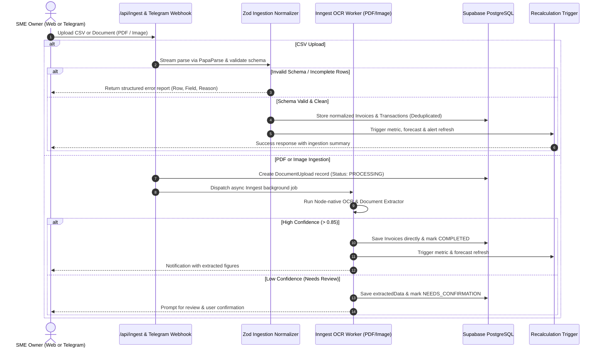

- **Predefined CSV Schema:**
  - Mandatory fields: `date` (YYYY-MM-DD), `description`, `amount` (float $> 0$), `type` (`RECEIVABLE` | `PAYABLE` | `EXPENSE`), `counterparty` (Customer or Supplier).
  - Optional fields: `invoiceNumber`, `dueDate`, `paymentStatus` (`PENDING`, `PAID`, `PARTIALLY_PAID`).
- **Validation & Deduplication Logic:**
  - Date normalization to UTC ISO strings.
  - Currency normalization and rounding to 2 decimal places.
  - Deduplication key: `hash(userId, invoiceNumber, counterparty, totalAmount)`.
  - Rejection policy: Fail closed. Never silently omit inconsistent data.

---

### Feature 2: Cash-Flow Forecasting Engine (30-Day Projection)

The forecasting engine operates purely mathematically to prevent financial hallucinations:

$$\text{Projected Balance}(t) = \text{Balance}(t-1) + \text{Inflows}(t) - \text{Outflows}(t)$$

Where:
- $\text{Balance}(0) = \text{Opening Verified Cash Balance}$.
- $\text{Inflows}(t) = \sum \text{Customer Receivables due on day } (t - \Delta_{\text{delay}})$.
  - $\Delta_{\text{delay}} = \text{Conservative late payment assumption days configured by user}$.
- $\text{Outflows}(t) = \sum \text{Supplier Payables due on day } t + \text{Scheduled Recurring Expenses (Rent, Payroll, Loan Repayments)}$.

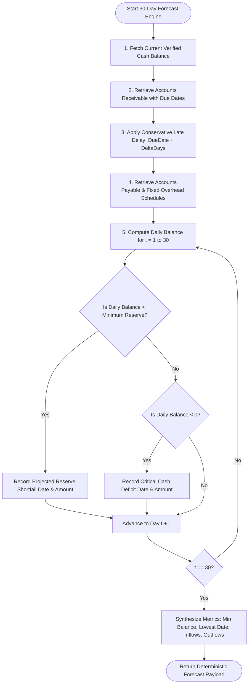

- **Scenario Modeling (Affordability Simulation):**
  - Copilot supports what-if scenarios (e.g., *"Can I afford to purchase ৳200,000 of inventory on Day 5?"*).
  - The engine injects a simulated outflow into day $t_k$, recalculates all 30 days, and checks if minimum cash reserve is violated on any subsequent day.

---

### Feature 3: Intelligent Financial Alerts Engine

A rule-based, deterministic engine detecting operational and liquidity hazards without relying on generative LLM heuristics.

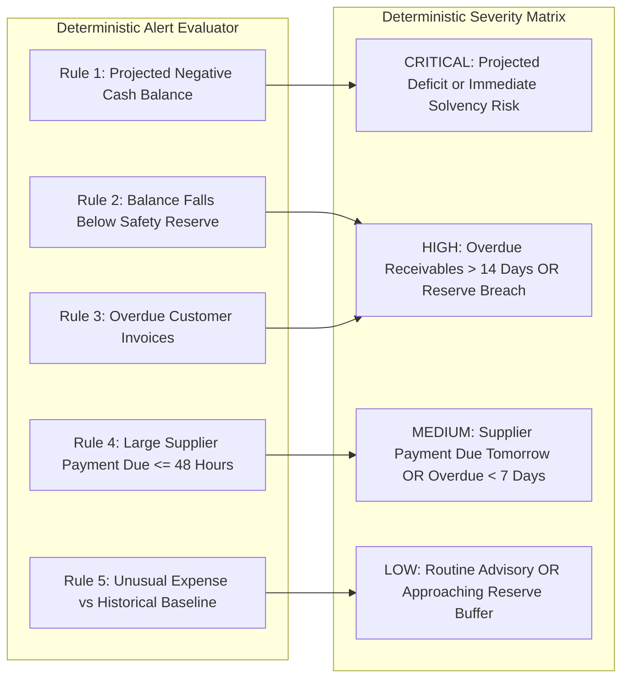

- **Alert Data Contract:**
  Each generated alert contains:
  1. `title`: Concise title (e.g., *"Projected Cash Deficit in 8 Days"*).
  2. `severity`: Deterministically assigned enum.
  3. `relevantDate`: Target milestone date.
  4. `impactAmount`: Exact numerical financial impact.
  5. `supportingData`: JSON array of driving invoice IDs, counterparties, and payment amounts.
  6. `suggestedAction`: Deterministic recommended procedure.

---

### Feature 4: Agentic Financial Copilot & Omni-Channel Orchestration

The AI Copilot operates as a **LangGraph StateGraph** connecting to explicit backend functions:

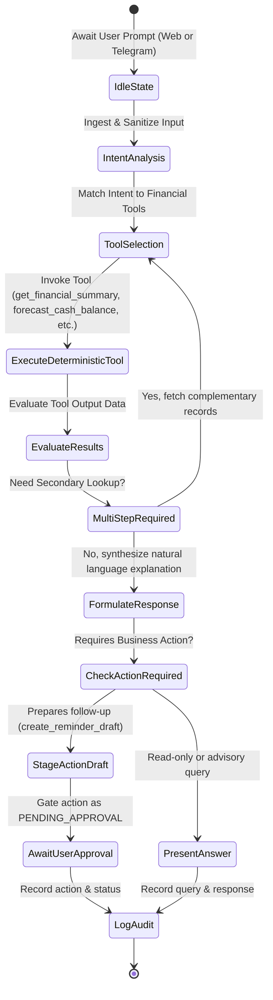

#### Deterministic Tool Specifications (Mandatory Backend Functions)

| Tool Identifier | Input Parameters | Output Payload | Purpose |
| :--- | :--- | :--- | :--- |
| `get_financial_summary` | `{ userId: string }` | `{ currentBalance, totalReceivables, totalPayables, minProjectedBalance, activeAlertsCount }` | Fetches real-time financial overview metrics. |
| `get_invoices` | `{ userId, type?, status?, counterparty?, limit? }` | `Invoice[]` | Searches invoices with filtering and pagination. |
| `get_upcoming_payables` | `{ userId, daysHorizon: number }` | `Transaction[] & Invoice[]` | Retrieves scheduled supplier obligations within $N$ days. |
| `get_upcoming_receivables` | `{ userId, daysHorizon: number }` | `Invoice[]` | Retrieves scheduled customer receipts within $N$ days. |
| `forecast_cash_balance` | `{ userId, days: 30, hypotheticalExpense?: { amount, date } }` | `{ dailyBalances, minBalance, minBalanceDate, breachesReserve }` | Runs deterministic 30-day projection & scenario testing. |
| `get_financial_alerts` | `{ userId, severity?: string }` | `FinancialAlert[]` | Retrieves active risks with supporting evidence. |
| `create_reminder_draft` | `{ userId, invoiceId: string, tone?: string }` | `{ draftId, recipient, subject, content, status: "DRAFT" }` | Formulates an overdue invoice follow-up draft using verified data. |
| `record_action_status` | `{ draftId: string, status: "APPROVED" \| "REJECTED" }` | `{ success: boolean, updatedStatus: string }` | Records user's explicit approval or rejection of a draft. |

---

### Feature 5: Invoice Follow-up & Action Planner

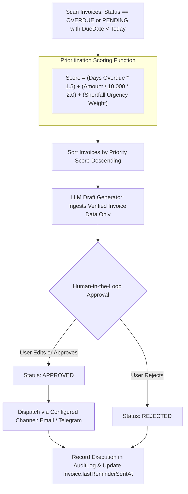

- **Anti-Hallucination Guardrail in Draft Generation:**
  - The LLM prompt is injected **exclusively** with verified invoice database records: `customerName`, `invoiceNumber`, `remainingAmount`, `originalDueDate`.
  - The model system instruction strictly prevents fabricating contract terms, bank routing numbers, or interest penalties.

---

### Feature 6: Activity & Security Audit Log (Enterprise Compliance)

To satisfy enterprise financial and banking standards, CashPilot AI maintains an append-only, tamper-evident audit record:
- **Captured Event Metadata:**
  - `actor`: `USER` (via Web UI), `AGENT` (autonomous recommendation), `SYSTEM` (cron job), `TELEGRAM` (via Bot).
  - `actionType`: `INGESTION`, `FORECAST_RUN`, `ALERT_DETECTED`, `DRAFT_CREATED`, `DRAFT_APPROVED`, `DRAFT_DISPATCHED`.
  - `entityId`: Reference UUID of the altered or generated entity.
  - `details`: JSON payload snapshot capturing state before and after mutation.
  - `ipAddress` & `createdAt`: Network origin and immutable UTC timestamp.

---

## 6. Omni-Channel Architecture: Telegram Bot & Web Integration

The Telegram Bot is an omnichannel extension sharing the identical execution context:

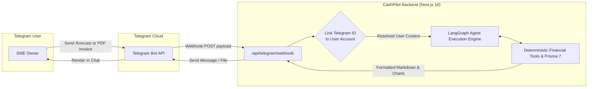

- **Telegram Authentication & Account Linking:**
  1. A user logs into the Web Dashboard and navigates to **Settings $\rightarrow$ Connect Telegram**.
  2. The system generates a cryptographic 6-digit one-time PIN (e.g. `CP-884213`) stored in `TelegramAccount` with a 15-minute expiry.
  3. The user opens the CashPilot Telegram Bot and enters `/link CP-884213`.
  4. The webhook verifies the PIN, associates `telegramUserId` and `chatId` with the user's `userId`, and marks `isVerified = true`.
  5. Subsequent commands and file uploads automatically resolve the authenticated business user context.

---

## 7. Implementation Roadmap & Technical Milestones

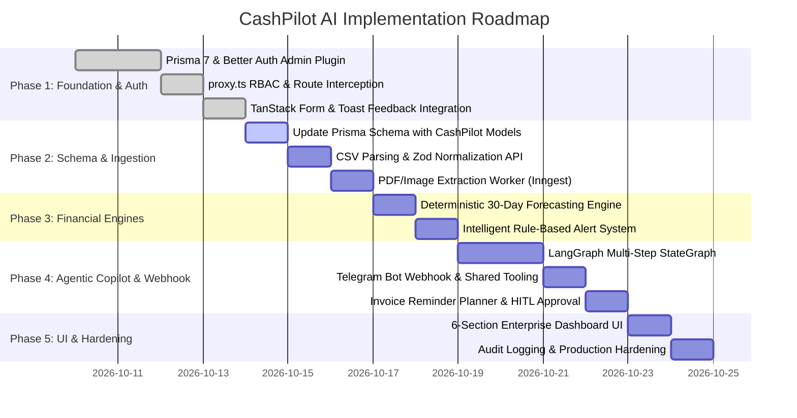
