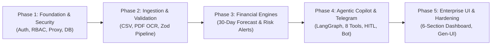

# CashPilot AI: Project Implementation Progress & Roadmap

This document serves as the single source of truth for the implementation progress of **CashPilot AI (Agentic AI for SME Financial Management)**. It translates the requirements from [`PROJECT_ARCHITECTURE.md`](./PROJECT_ARCHITECTURE.md), [`DESIGN.md`](./DESIGN.md), and [`AGENTS.md`](../AGENTS.md) into 5 decoupled, testable execution phases with granular checklists.

---

## High-Level Execution Phases

---

## Phase 1: Foundation, Security Boundary & Authentication Architecture

> **Core Objective:** Establish the edge boundary, stateful multi-role session management, database layer, and UI component foundations.

- [x] **Runtime & Package Management:** Next.js 16 App Router on `bun` with script pipeline (`dev`, `build`, `lint`, `format`, `db:*`).
- [x] **Design Token Foundation:** Tailwind CSS v4 setup and Shadcn UI core primitives (`button.tsx`, `card.tsx`, `input.tsx`, `label.tsx`).
- [x] **Prisma 7 Database Layer:** Setup Prisma 7 (`v7.10.0`) with `@prisma/adapter-pg` driver adapter connected to Supabase PostgreSQL via `prisma7.config.ts`.
- [x] **Modular Schema Architecture:** Clean `/prisma` folder structure with root `schema.prisma`, domain `enum.prisma`, and dedicated single-model schema files.
- [x] **Better Auth Server Setup:** Better Auth server instance (`src/lib/auth.ts`) using Prisma adapter and `admin({ defaultRole: "user", adminRole: "admin" })` plugin.
- [x] **Better Auth Client Setup:** React client instance (`src/lib/auth-client.ts`) equipped with `adminClient()`.
- [x] **Auth API Route:** Catch-all endpoint mounted at `src/app/api/auth/[...all]/route.ts`.
- [x] **Edge Route Protection (`src/proxy.ts`):** Edge interception enforcing session checks, protecting `/dashboard` and `/admin`, and redirecting unauthenticated requests to `/sign-in`.
- [x] **Automated Admin Seeding:** Script (`src/lib/seed-admin.ts`) hooked into server startup via `src/instrumentation.ts` to seed credentials from `.env`.
- [x] **Authentication Views:** Sign-In (`src/app/(auth)/sign-in/page.tsx`) and Sign-Up (`src/app/(auth)/sign-up/page.tsx`) built with `@tanstack/react-form` and runtime Zod validation.
- [x] **Feedback & Notifications:** Mounted `react-hot-toast` with top-right positioning (`src/components/toaster.tsx`) in root layout.
- [x] **Baseline Protected Dashboards:** Initial views for User Dashboard (`/dashboard`) and Admin Dashboard (`/admin`) displaying session details and sign-out controls.
- [x] **Edge Rate Limiting:** Integrate Upstash Redis client into `src/proxy.ts` for sliding-window IP rate limiting.

---

## Phase 2: Data Ingestion & Multi-Format Validation Pipeline (Feature 1)

> **Core Objective:** Multi-channel financial data ingestion (Web & Telegram), zero-trust validation, OCR extraction, deduplication, and automatic recalculation triggers.

- [x] **Database Schema Deployment:** All CashPilot ERD models and enums deployed to PostgreSQL (`User`, `BusinessProfile`, `RecurringSchedule`, `Invoice`, `Transaction`, `FinancialAlert`, `ActionDraft`, `DocumentUpload`, `AuditLog`, `TelegramAccount`, `Conversation`, `Message`).
- [x] **Business Profile & Settings Service:** Initialize and manage SME financial settings (operational currency `৳`/`$`, opening cash balance, safety reserve threshold, late payment delay buffer).
- [x] **CSV Ingestion Route:** Endpoint (`/api/ingest/csv`) parsing in-memory via `papaparse` with accounts receivable (AR) and accounts payable (AP) Zod schemas.
- [x] **Deduplication Engine:** Ingestion hash calculation (`hash(userId, invoiceNumber, counterparty, totalAmount)`) and database ledger checks preventing duplicate entries.
- [x] **Structured Error Reporting:** Detailed row-by-row and column validation failure reports (fail-closed, no silent drops).
- [x] **Inngest Background Worker Setup:** Inngest client and webhook handler (`/api/inngest`) for durable asynchronous execution.
- [x] **Document OCR Extraction Worker:** Inngest background job extracting invoices from PDFs/images using Node-native parsing (`pdf-parse`) and Gemini Flash structured extraction.
- [x] **Sample PDF Fixtures:** 8 distinct PDF invoices across AR and AP with varied layouts, typography, and styling located in `data/` for end-to-end OCR testing.
- [x] **OCR Uncertainty Review Gate:** Flagging extractions with confidence $< 0.85$ as `NEEDS_CONFIRMATION` to stage raw data before ledger persistence.
- [x] **Multi-Format Upload Dropzone:** Drag-and-drop web UI with live MIME-type checks, single-CSV rule enforcement, batch PDF/image support, and validation error breakdown.
- [x] **Human-in-the-Loop (HITL) Ingestion Review:** Staging modal previewing parsed AR/AP records, live totals, selective inclusion, duplicate alerts, and user confirmation before DB write.
- [x] **Enterprise API Response Standardization:** Enterprise `ApiResponse` wrapper across all endpoints enforcing strict envelope (`success`, `statusCode`, `message`, `data`, `errors`, `meta`, `timestamp`).
- [x] **Monthly Ledger Maintenance & Deletion:** Month-based filtering (`YYYY-MM`), batch and single invoice deletion with cascading transaction cleanup and audit trail.
- [x] **Metric Recalculation Trigger:** Automatic event dispatch (`invoice.ledger.mutated`) to recalculate financial summary, overdue list, and cash-flow projections upon successful ingestion or deletion.

---

## Phase 3: Deterministic Financial Engines & Risk Alerting (Features 2 & 3)

> **Core Objective:** Pure TypeScript mathematical calculation engines for 30-day cash flow projection, what-if scenario testing, and rule-based risk alerts.

- [ ] **30-Day Cash-Flow Forecasting Engine:** Deterministic calculation module ($Balance(t) = Balance(t-1) + Inflows(t) - Outflows(t)$) in pure TypeScript.
- [ ] **Conservative Late Receipt Modeling:** Applying user-configured delay buffers ($\text{Due Date} + \Delta_{\text{late}}$) to expected receivables.
- [ ] **Recurring Overhead Scheduling:** Projecting `RecurringSchedule` commitments (Rent, Payroll, Loan Repayments) on their scheduled day of the month.
- [ ] **What-If Affordability Simulator:** Scenario simulation engine testing hypothetical purchases (e.g. _"Can I afford ৳200,000 of inventory on Day 5?"_) against the 30-day timeline.
- [ ] **Deficit & Low-Cash Period Detection:** Flagging dates where balances breach the safety reserve or drop into negative territory.
- [ ] **Rule-Based Intelligent Alerts Engine:** Evaluating the 5 core deterministic rules:
  1. Projected cash deficit (negative balance).
  2. Safety reserve threshold breach.
  3. Overdue customer invoices ($>14$ days, $<7$ days).
  4. Upcoming large supplier payments (due $\le 48$ hours).
  5. Unusual expense anomalies relative to monthly baseline.
- [ ] **Deterministic Severity Scoring Matrix:** Assigning severity (`CRITICAL`, `HIGH`, `MEDIUM`, `LOW`) without LLM hallucination.
- [ ] **Root-Cause Attribution:** Attaching structured `supportingData` (driving invoice IDs, counterparties, and amounts) to each alert.
- [ ] **Nightly Recalculation Cron:** Inngest scheduled worker running nightly 30-day projections and updating active alerts.

---

## Phase 4: Agentic Copilot, Tool Layer & Omni-Channel Telegram Bot (Features 4 & 5)

> **Core Objective:** Multi-step LangGraph agent orchestrator, 8 deterministic backend tools, Human-in-the-Loop action planner, and shared Telegram bot.

- [ ] **LLM Provider Bridge:** Google Gemini 1.5 Flash (primary via `@langchain/google-genai`) with Groq Llama-3 failover (`@langchain/groq`).
- [ ] **The 8 Mandatory Backend Tools:** Implement and strictly type all 8 tools:
  1. `get_financial_summary`: Real-time KPI metrics.
  2. `get_invoices`: Filtered and paginated invoice search.
  3. `get_upcoming_payables`: Scheduled supplier obligations and overhead within $N$ days.
  4. `get_upcoming_receivables`: Expected customer receipts within $N$ days.
  5. `forecast_cash_balance`: 30-day daily projection and affordability simulation.
  6. `get_financial_alerts`: Active risks with supporting attribution.
  7. `create_reminder_draft`: Factual invoice reminder draft generation.
  8. `record_action_status`: Recording explicit user approval/rejection.
- [ ] **LangGraph StateGraph Engine:** Multi-step state machine managing conversational memory, tenancy context, and tool calling.
- [ ] **Streaming Chat Route Handler:** `/api/chat` streaming SSE responses using Vercel AI SDK and `@ai-sdk/langchain`.
- [ ] **Overdue Receivables Prioritizer:** Prioritization scoring based on days overdue, balance amount, and deficit urgency.
- [ ] **Factual Reminder Generator:** LLM prompt guardrails restricting draft copy to verified database fields only.
- [ ] **Human-in-the-Loop (HITL) Approval Flow:** Enforcing draft approval states (`DRAFT` $\rightarrow$ `PENDING_APPROVAL` $\rightarrow$ `APPROVED` | `REJECTED` $\rightarrow$ `SENT`).
- [ ] **Telegram Bot Webhook (`/api/telegram/webhook`):** Telegram Bot API integration routing updates to the shared agent backend.
- [ ] **Telegram Account Linking:** 6-digit cryptographic PIN pairing flow (`/link <code>`) resolving to Better Auth `userId`.
- [ ] **Shared Telegram Copilot Capabilities:** Telegram commands (`/summary`, `/forecast`, `/alerts`), natural language chat, and invoice PDF upload handling.
- [ ] **Immutable Audit Logger:** Append-only logging service recording all agent recommendations, tool calls, and user approvals in `AuditLog`.

---

## Phase 5: Enterprise UI/UX Dashboard, Generative UI & Production Hardening (Feature 6)

> **Core Objective:** High-density 6-section command center, Generative UI chat widgets, interactive HITL approval modals, and production audits.

- [ ] **Section 1: Financial Overview:** 6 KPI metric cards with real-time figures, currency formatting (`৳`/`$`), and trend badges.
- [ ] **Section 2: Cash-Flow Forecast Chart:** Interactive 30-day timeline chart with reserve threshold line, deficit zones, and transaction driver drawer.
- [ ] **Section 3: Alerts & Recommended Actions Feed:** Prioritized cards with severity badges, root-cause breakdown, and inline action buttons.
- [x] **Section 4: Invoice Management Ledger:** Searchable, filterable AR/AP data table with partial payment progress, status chips, and action menus.
- [ ] **Section 5: AI Copilot Chat Interface:** Docked streaming panel with quick prompt pills (_"Can I afford ৳200,000?"_, _"Who owes me most?"_) and Generative UI widgets (mini forecast charts, invoice reminder cards).
- [ ] **Section 6: Activity & Security Audit Log View:** Auditable event timeline with actor icons (`USER`, `AGENT`, `SYSTEM`, `TELEGRAM`), action tags, and JSON payload inspection dialog.
- [ ] **HITL Action Approval Modal:** Interactive review modal allowing the user to inspect, edit, and confirm or reject overdue reminder drafts.
- [ ] **Telegram Account Pairing UI:** Settings panel allowing the user to generate a linking PIN and inspect connection status.
- [ ] **Tenant Isolation & Security Audit:** Verifying strict `userId` scoping across every query, sanitizing PII in logs, and stress-testing edge boundaries.
