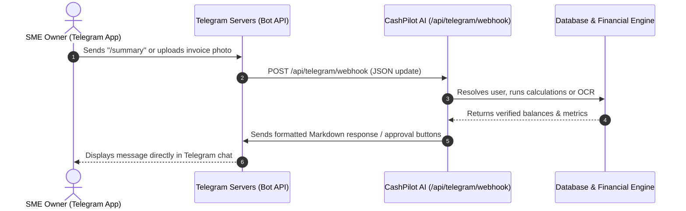
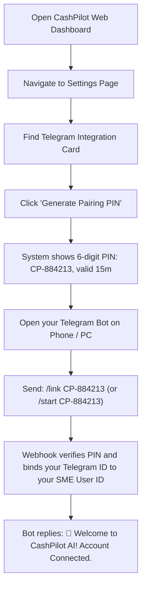

# 🤖 Complete Guide: Telegram Integration with CashPilot AI

> **Target Audience:** Beginners and First-Time Developers  
> **Prerequisites:** A Telegram account and your running CashPilot AI project  
> **Estimated Setup Time:** 10 – 15 minutes  

---

## 📖 Table of Contents

1. [Introduction: How Telegram Connects to CashPilot](#1-introduction-how-telegram-connects-to-cashpilot)
2. [Step 1: Create Your Telegram Bot (via BotFather)](#2-step-1-create-your-telegram-bot-via-botfather)
3. [Step 2: Configure Environment Variables in CashPilot](#3-step-2-configure-environment-variables-in-cashpilot)
4. [Step 3: Expose Your Local Server to the Internet (Webhook Setup)](#4-step-3-expose-your-local-server-to-the-internet-webhook-setup)
5. [Step 4: Register the Webhook with Telegram](#5-step-4-register-the-webhook-with-telegram)
6. [Step 5: Pair Your Business Account with Telegram](#6-step-5-pair-your-business-account-with-telegram)
7. [Step 6: What You Can Do in Telegram (Features & Commands)](#7-step-6-what-you-can-do-in-telegram-features--commands)
8. [Step 7: Verification & Testing Checklist](#8-step-7-verification--testing-checklist)
9. [Troubleshooting & Frequently Asked Questions](#9-troubleshooting--frequently-asked-questions)

---

## 1. Introduction: How Telegram Connects to CashPilot

### What is this integration?
CashPilot AI is an **omnichannel financial assistant**. This means you and your team don't have to stay glued to a computer dashboard all day. By connecting your Telegram app to CashPilot, you can:
- Check your cash runway on your phone while on the go.
- Receive instant warnings when you are in danger of running out of money.
- Snap a photo or forward a PDF of a supplier invoice right inside Telegram to ingest it automatically into your ledger.
- Approve or reject customer payment reminder messages with a single tap on interactive buttons.

### How does it work under the hood? (The "Webhook" explained)
In simple terms:
1. When you send a message or invoice to your bot in Telegram, Telegram's servers receive it.
2. Telegram immediately forwards that message to CashPilot AI via an HTTP POST request. This forwarding URL is called a **Webhook**.
3. CashPilot's endpoint (`/api/telegram/webhook`) checks who sent the message, executes our verified financial tools or AI logic, and replies back to your Telegram chat instantly.



---

## 2. Step 1: Create Your Telegram Bot (via BotFather)

Telegram provides an official bot called **@BotFather** that manages all bot creation. You do not need to write code to create the bot itself.

### Detailed Steps:
1. Open the **Telegram app** on your phone or desktop computer.
2. In the search bar at the top, search for `@BotFather`. Look for the verified blue checkmark.
3. Click **Start** (or send `/start`).
4. Send the command:
   ```text
   /newbot
   ```
5. BotFather will ask: *"Alright, a new bot. How are we going to call it? Please choose a name for your bot."*
   - Type a friendly display name (e.g., `CashPilot Copilot` or `My Company Finance Bot`).
6. BotFather will ask for a **username**: *"Good. Now let's choose a username for your bot. It must end in `bot`."*
   - Type a unique username ending in `bot` (e.g., `cashpilot_sme_finance_bot` or `acme_finance_bot`).
7. BotFather will reply with a congratulatory message containing your **HTTP API Token**. It looks like this:
   ```text
   7123456789:AAFlkB4_exampleToken_d8jK92aQxY
   ```

> [!IMPORTANT]
> **Keep your API Token secret!** Anyone who has this token can control your bot. Never commit it to a public GitHub repository.

---

## 3. Step 2: Configure Environment Variables in CashPilot

Now that you have your Bot Token, you need to provide it to your CashPilot application.

1. In your project root folder (`d:\01_coding\exploration\sme_finance_copilot`), open your `.env` file (create one from `.env.example` if it doesn't exist).
2. Add the following lines to your `.env`:
   ```bash
   # -----------------------------------------------------------------------------
   # Telegram Bot Configuration
   # -----------------------------------------------------------------------------
   TELEGRAM_BOT_TOKEN="7123456789:AAFlkB4_exampleToken_d8jK92aQxY"
   TELEGRAM_BOT_USERNAME="your_bot_username_without_at"
   ```
   *(Replace the values with the actual token and username you got from BotFather).*
3. Save the `.env` file.

---

## 4. Step 3: Expose Your Local Server to the Internet (Webhook Setup)

> [!NOTE]
> Telegram servers cannot send messages to `http://localhost:3000` because `localhost` only exists on your computer. Telegram requires a secure, public **HTTPS** URL.
> - **In Production:** This will be your real domain (e.g. `https://cashpilot.yourcompany.com`).
> - **In Local Development:** You need a free tunneling tool (like **ngrok** or **Cloudflare Tunnel**) to create a temporary public HTTPS link to your local computer.

### Option A: Using Ngrok (Recommended for Beginners)
1. Download **ngrok** from [ngrok.com](https://ngrok.com) or install it via winget / scoop / chocolatey.
2. Ensure your CashPilot dev server is running:
   ```bash
   bun run dev
   ```
   *(Your app runs on port 3000 by default).*
3. In a new command prompt or terminal window, start ngrok:
   ```bash
   ngrok http 3000
   ```
4. Ngrok will show a screen like this:
   ```text
   Forwarding   https://a1b2-103-24-12-8.ngrok-free.app -> http://localhost:3000
   ```
5. Copy the `https://...ngrok-free.app` URL. That is your **Public Base URL**.

---

## 5. Step 4: Register the Webhook with Telegram

Now, tell Telegram where to send incoming messages. You only need to do this **once** (or whenever your ngrok URL changes).

### Method 1: Using your Web Browser (Easiest)
Replace `<YOUR_BOT_TOKEN>` and `<YOUR_PUBLIC_URL>` in the following URL and paste it into your browser's address bar:

```text
https://api.telegram.org/bot<YOUR_BOT_TOKEN>/setWebhook?url=<YOUR_PUBLIC_URL>/api/telegram/webhook
```

**Concrete Example:**
If your bot token is `7123456789:AAFlkB4...` and your ngrok URL is `https://a1b2-103-24-12-8.ngrok-free.app`, the full link is:
```text
https://api.telegram.org/bot7123456789:AAFlkB4.../setWebhook?url=https://a1b2-103-24-12-8.ngrok-free.app/api/telegram/webhook
```

Press **Enter**. Telegram will reply in your browser with:
```json
{
  "ok": true,
  "result": true,
  "description": "Webhook was set"
}
```

### Method 2: Using cURL or PowerShell
```powershell
curl "https://api.telegram.org/bot<YOUR_BOT_TOKEN>/setWebhook?url=<YOUR_PUBLIC_URL>/api/telegram/webhook"
```

### How to check if your Webhook is working:
Visit this URL in your browser:
```text
https://api.telegram.org/bot<YOUR_BOT_TOKEN>/getWebhookInfo
```
If you see `"url": "https://.../api/telegram/webhook"` and `"has_custom_certificate": false`, your webhook is properly registered and listening!

---

## 6. Step 5: Pair Your Business Account with Telegram

Because CashPilot is an enterprise system with strict tenant data isolation, a Telegram chat **cannot** view any financial data until it is paired with an authorized CashPilot user account.

We use a secure **One-Time 6-Digit PIN Pairing Protocol**:



### Step-by-Step Walkthrough:
1. Log into your **CashPilot Web Dashboard** (`http://localhost:3000`).
2. Click **Settings** in the left sidebar navigation.
3. At the top of the settings page, you will see the **Telegram Omni-Channel Connection** card.
4. Click the **"Generate Pairing PIN"** button.
5. A unique code will appear (e.g. `CP-884213`) with a 15-minute countdown timer.
6. Open your bot in the Telegram app and click **Start** or send:
   ```text
   /link CP-884213
   ```
7. The bot will instantly respond with a welcome message confirming that your Telegram account is now securely linked to your SME business profile!

---

## 7. Step 6: What You Can Do in Telegram (Features & Commands)

Once connected, your bot shares the **exact same database, calculation engine, and AI copilot** as the web dashboard.

### 1. Instant Financial Commands
| Command | What It Does |
| :--- | :--- |
| `/summary` | Gives you an immediate snapshot of your cash balance, total incoming receivables, scheduled outgoings, and reserve status. |
| `/forecast` | Runs the deterministic 30-day mathematical projection. Tells you your minimum expected cash balance, lowest balance date, and warns if you risk a deficit. |
| `/alerts` | Lists all active financial risks (e.g. overdue invoices, large supplier bills due in 48 hours). |
| `/plan` | Analyzes overdue customer payments and prepares reminder drafts. |

### 2. Conversational AI Copilot (Ask Anything)
You can type natural language questions directly to the bot. The bot invokes the **LangGraph Agent** with access to your business tools:
- *"Can I afford to purchase ৳250,000 in raw materials on Thursday?"*
- *"Who owes me the most money right now?"*
- *"When will my cash balance reach its lowest point this month?"*

The AI will **never hallucinate math**. It queries your database, executes mathematical simulations, and replies in plain, clear language.

### 3. Upload Invoices & Receipts on the Go (OCR Ingestion)
- Have a paper receipt or supplier invoice? Take a photo with your phone camera and send it to the bot.
- Have a PDF invoice? Forward or upload the `.pdf` file to the bot.
- **What happens:**
  1. CashPilot downloads the document bytes.
  2. Creates a pending document record tagged as `source: "TELEGRAM"`.
  3. Dispatches background OCR extraction via Inngest.
  4. Automatically updates your accounts payable/receivable once validated!

### 4. Interactive Human-in-the-Loop (HITL) Action Approvals
When an alert or overdue invoice needs attention, the bot can send you an **Action Card** with inline buttons:
```text
🚨 Action Required: Overdue Invoice Reminder
Customer: Bengal Textiles Ltd
Amount: ৳75,000 (Due 12 days ago)

Draft Message:
"Dear Accounts Team, this is a courteous follow-up regarding invoice INV-2026-004..."

[ ✅ Approve & Send ]   [ ❌ Dismiss ]
```
- Tapping **Approve & Send** updates the record in your database, triggers the dispatch, and logs the action in the immutable `AuditLog`.
- Tapping **Dismiss** marks the draft as rejected without sending anything.

---

## 8. Step 7: Verification & Testing Checklist

Use this quick checklist to ensure your setup is 100% operational:

- [ ] `TELEGRAM_BOT_TOKEN` is set in `.env` and dev server has been restarted.
- [ ] Ngrok tunnel is running with HTTPS forwarding to port `3000`.
- [ ] Visiting `https://api.telegram.org/bot<TOKEN>/getWebhookInfo` shows `"ok": true`.
- [ ] In CashPilot Settings, generated a pairing code (e.g. `CP-XXXXXX`).
- [ ] Sent `/link CP-XXXXXX` to the bot and received a confirmation message.
- [ ] Tested `/summary` command and received your company's actual cash balance.
- [ ] Tested `/forecast` command and received the 30-day runway projection.
- [ ] Uploaded an image or PDF and received confirmation that the invoice is being processed.

---

## 9. Troubleshooting & Frequently Asked Questions

### 1. The bot is not replying to any messages
- **Check 1:** Is your local dev server running (`bun run dev`)?
- **Check 2:** Is your ngrok tunnel active? If you restarted ngrok, your public URL changed, so you must re-run the `setWebhook` step with the new URL.
- **Check 3:** Visit `https://api.telegram.org/bot<TOKEN>/getWebhookInfo`. If `last_error_message` says `"Connection refused"` or `"SSL error"`, check that your ngrok tunnel is forwarding to the correct port (`3000`).

### 2. The bot says *"Account Not Linked"*
- This is normal security behavior for unauthenticated chats.
- Go to the CashPilot Web Dashboard $\rightarrow$ **Settings**, generate a new 6-digit PIN, and send `/link CP-XXXXXX` in Telegram.

### 3. The pairing code says *"Invalid or expired pairing code"*
- Pairing PINs are valid for **15 minutes** for security. If 15 minutes have passed, click "Generate Pairing PIN" again on the web dashboard to get a fresh code.

### 4. Do I need to re-register the webhook in Production?
- Yes. Once you deploy CashPilot to a production host (e.g., Vercel, Railway, AWS) with your custom domain (e.g., `https://copilot.yourdomain.com`), run `setWebhook` once pointing to your permanent production URL:
  ```text
  https://api.telegram.org/bot<TOKEN>/setWebhook?url=https://copilot.yourdomain.com/api/telegram/webhook
  ```
  Once set, it remains permanently active without needing ngrok.

---

*Document maintained for CashPilot AI (Agentic AI for SME Financial Management).*

